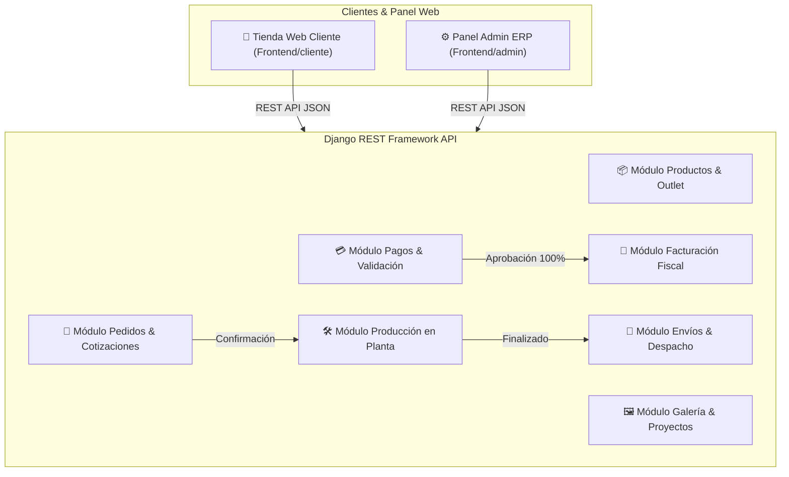

# TuEstante 🏢📦

**TuEstante** es una plataforma integral de **Comercio Electrónico y Sistema ERP de Gestión Operativa** especializada en el diseño, fabricación, personalización y comercialización de mobiliario metálico comercial e industrial (estanterías pesadas y livianas, lockers modulares, archivadores, gabinetes ejecutivos y soluciones de almacenamiento a medida).

El sistema se divide en dos entornos principales:
1. **Tienda Web (Cliente):** Experiencia de e-commerce pública con catálogo interactivo, visualización multi-ángulo de productos, selección de colores/acabados, sección de ofertas *Outlet* con stock controlado y flujo de compra con pasarela de pagos flexible.
2. **Panel de Administración (ERP):** Consola operacional para la gestión de productos, aprobación de pagos, emisión de facturas fiscales, control de órdenes de producción en planta, seguimiento de despachos y gestión del portafolio corporativo.

---

## 🏗️ Arquitectura General del Sistema

El proyecto sigue una arquitectura desacoplada con un **Backend REST API en Django** y **Frontend Modular en Javascript Vainilla (ES Modules)**.



---

## 🧰 Tecnologías Utilizadas

### Backend
- **Lenguaje:** Python 3.10+
- **Framework:** Django 5.x + Django REST Framework (DRF)
- **Gestión de Entorno:** Pipenv / Virtualenv
- **Arquitectura de Modelos:** Auditoría y borrado lógico unificado (`BaseModel` con `is_deleted` y `deleted_at`)
- **Base de Datos:** SQLite (Desarrollo) / PostgreSQL (Producción)

### Frontend
- **Core:** HTML5 Semántico + Javascript Vainilla (ES Modules)
- **Estilos:** Vanilla CSS3 con variables personalizadas, Glassmorphism, Responsive Web Design y animaciones fluídas
- **Iconografía & Tipografía:** Google Fonts (Outfit, Inter) y FontAwesome / Lucide Icons

---

## ⚙️ Contexto de Dominio y Módulos del Sistema

### 1. 📦 Productos y Sección Outlet (`apps/product`)
- **Catálogo Técnico:** Organización de productos por **Tipos de Producto** (`ProductType`), definiendo dimensiones técnicas (alto, ancho, profundidad), calibre de lámina, capacidad de carga por bandeja y tipos de cerraduras/seguridad.
- **Variantes Visuales:**
  - **Ángulos de Vista (`ProductAngleImage`):** Galería de imágenes con perspectivas (frentera, lateral, 3/4, interna) para inspección técnica del producto.
  - **Acabados y Colores (`ProductColorImage`):** Muestrario de pintura electrostática disponible por producto.
- **Zona Outlet & Liquidación (`is_outlet`):**
  - Los productos marcados como `is_outlet = True` manejan un **stock limitado específico (`quantity`)**.
  - **Regla de Negocio:** Cuando un producto Outlet agota su existencia (`quantity <= 0`), la aplicación inactiva automáticamente el producto (`is_active = False`), impidiendo nuevas compras.

### 2. 📝 Pedidos y Cotizaciones (`apps/orders`)
- Registra la intención de compra del cliente junto con las especificaciones de personalización (color de pintura seleccionado, observaciones de diseño y requerimientos de instalación).
- Flujo de estados de la orden:
  `pending` ➡️ `confirmed` ➡️ `in_production` ➡️ `shipped` ➡️ `delivered` (o `cancelled`).

### 3. 💳 Pagos y Finanzas (`apps/payment`)
Soporta dos esquemas flexibles de pago según el tipo de producto o acuerdo comercial:
1. **Esquema Parcial (50% Inicial / 50% Final):** Permite iniciar la fabricación en planta con un abono inicial del 50%. El 50% restante se liquida previa o posterior a la entrega.
2. **Esquema de Pago Único / Total (`payment_stage = 'total'`):** Permite cancelar el 100% del valor de la orden en una única transacción.

### 4. 🧾 FacturaciónFiscal Automatizada (`apps/invoice`)
- **Regla de Negocio:** Al aprobarse el pago que completa el **100% del monto total de la orden** (sea mediante la aprobación del pago único total o del comprobante del saldo final), el sistema invoca automáticamente el módulo de facturación (`create_invoice_for_order`), emitiendo la factura fiscal correspondiente vinculada al pedido.

### 5. 🛠️ Producción y Planta (`apps/production`)
- Al confirmarse el pago inicial de una orden, se genera automáticamente una **Orden de Producción** para el taller de fabricación.
- Permite a los operadores supervisar el avance de corte, doblado de lámina, soldadura, pintura al horno y ensamblado final.

### 6. 🚚 Envíos y Logística (`apps/shipment`)
- Gestión de despachos, asignación de empresas de transporte/flete, generación de guías y registro de firmas de entrega a conformidad.

### 7. 🖼️ Galería y Proyectos Corporativos (`apps/gallery` / `apps/project`)
- Catálogo visual de instalaciones reales y proyectos industriales ejecutados a medida para clientes corporativos (bodegas, centros logísticos, oficinas).

---

## 🔒 Reglas de Negocio Clave

1. **Borrado Lógico Unificado (Soft Delete):** Ningún registro clave (Productos, Pedidos, Pagos) se elimina físicamente de la base de datos. Todos heredan de `BaseModel`, conservando trazabilidad e historial auditado.
2. **Inactivación Automática de Stock Outlet:** Cuando la cantidad disponible (`quantity`) de un producto Outlet llega a cero, el backend inactiva automáticamente el producto impidiendo su visualización en tienda pública.
3. **Validación Rurosa de Pagos:** La producción en planta no puede iniciarse sin la aprobación administrativa del primer pago (50% o 100%).
4. **Disparo Automatizado de Factura Fiscal:** La emisión de la factura fiscal es un evento del sistema gatillado exclusivamente cuando el saldo restante pagado de la orden es \$0.00.

---

## 📂 Estructura del Repositorio

```text
TuEstante/
├── Backend/                    # Aplicación Django (API REST)
│   ├── apps/
│   │   ├── base/               # Modelo abstracto BaseModel con auditoría y soft delete
│   │   ├── product/            # Gestión de productos, colores, ángulos y outlet
│   │   ├── orders/             # Órdenes de compra y detalle de ítems
│   │   ├── payment/            # Registro y validación de pagos (50/50 y 100%)
│   │   ├── invoice/            # Generación de facturas fiscales automatizadas
│   │   ├── production/         # Seguimiento de órdenes de trabajo en planta
│   │   ├── shipment/           # Logística y guías de despacho
│   │   ├── gallery/            # Galería de imágenes destacadas
│   │   ├── project/            # Proyectos ejecutados para clientes corporativos
│   │   └── user/               # Usuarios, autenticación y roles
│   ├── tu_estante/             # Configuración principal de Django (settings, urls)
│   ├── manage.py
│   └── Pipfile                 # Dependencias del backend (Pipenv)
│
├── Frontend/                   # Aplicaciones Cliente y Panel Admin
│   ├── cliente/                # Tienda web pública (E-commerce)
│   │   ├── index.html          # Página principal / Catálogo
│   │   ├── modules/            # Módulos JS (productos, carrito, checkout, outlet)
│   │   └── assets/             # Estilos CSS y recursos multimedia
│   │
│   └── admin/                  # Panel de administración ERP
│       ├── index.html          # Dashboard principal
│       ├── modules/            # Módulos JS para gestión (productos, órdenes, pagos)
│       └── assets/             # Estilos CSS del panel admin
└── README.md                   # Documentación general del proyecto
```

---

## 🚀 Guía de Ejecución Local

### Prerrequisitos
- Python 3.10 o superior
- Pipenv (`pip install pipenv`)
- Navegador web moderno (Chrome, Firefox, Edge, Safari)

### 1. Configuración del Backend

```bash
# Navegar al directorio del backend
cd Backend

# Activar el entorno virtual e instalar dependencias
pipenv install

# Entrar a la shell de Pipenv
pipenv shell

# Aplicar las migraciones a la base de datos
python manage.py migrate

# Ejecutar el servidor de desarrollo Django
python manage.py runserver
```
El servidor backend se iniciará en `http://127.0.0.1:8000/`.

### 2. Ejecución de Pruebas Automatizadas del Backend

Para validar la integridad de las reglas de negocio, modelos y endpoints:
```bash
python manage.py test
```

### 3. Configuración del Frontend

No requiere proceso de compilación (sin Webpack/Vite), ya que utiliza **ES Modules** nativos del navegador.
- **Tienda Cliente:** Abrir `Frontend/cliente/index.html` mediante un servidor HTTP estático (ej. `python -m http.server` o la extensión Live Server de VS Code).
- **Panel Admin:** Abrir `Frontend/admin/index.html` mediante un servidor HTTP estático.
